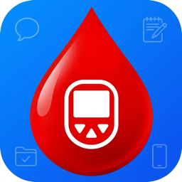
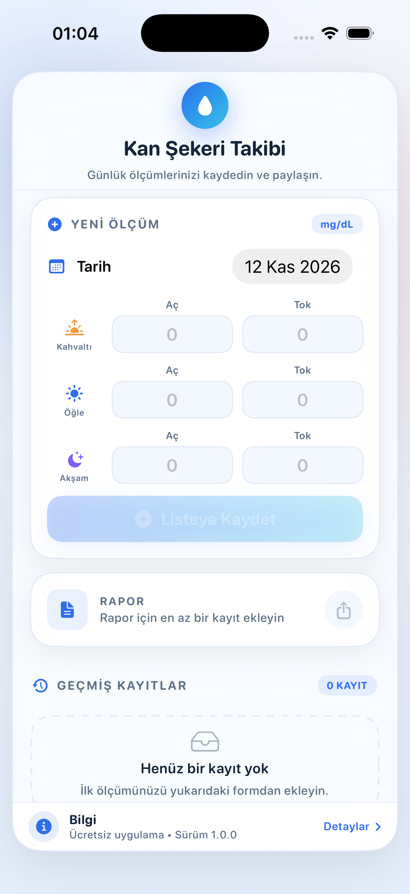
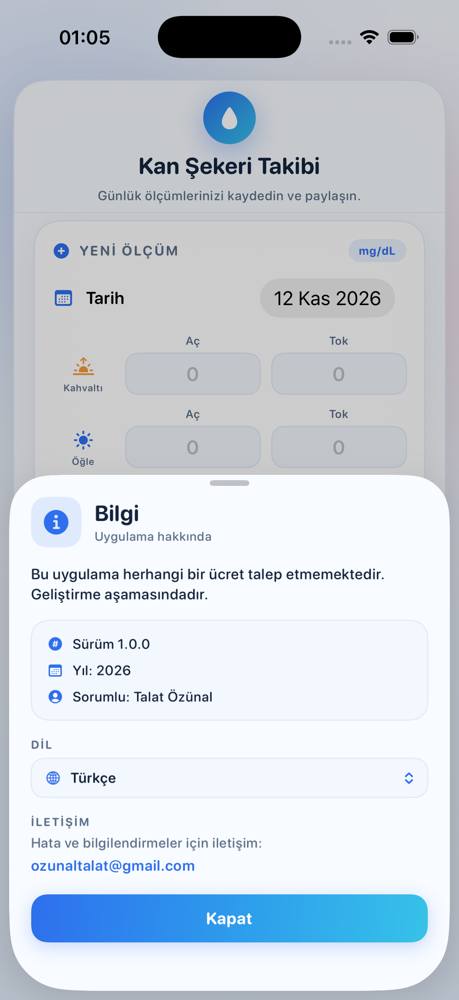

<p align="center">
  
</p>

<h1 align="center">Kan Şekeri Takibi</h1>

<p align="center">
  A calm, single-screen blood sugar diary for iPhone and iPad.<br>
  Record morning, noon and evening readings, keep them on your device, and share a clean text report.<br>
  Available in Turkish, English, German, French and Italian.
</p>

<p align="center">
  <b>English</b> · <a href="README.tr.md">Türkçe</a>
</p>

<p align="center">
  
  
  
  
</p>

---

## Overview

**Kan Şekeri Takibi** (Turkish for *Blood Sugar Tracking*) is a small SwiftUI app that helps a person keep a daily log of blood glucose measurements. For each day it records **fasting (aç)** and **post-meal (tok)** values for **breakfast, lunch and dinner** — six numbers that fit on one comfortable screen.

Everything stays on the device. There is no account, no server, no analytics and no third-party dependency.

## Why this app exists

Managing diabetes is mostly about consistency: measuring at the right moments and being able to show the pattern to a doctor. Paper notebooks get lost, and full-featured medical apps can feel heavy for a simple daily habit.

This app is intentionally narrow:

- **One job** — write down today's readings quickly.
- **One screen** — no tabs, no menus, no setup.
- **One device** — data is stored locally in `AppStorage`, never uploaded.
- **One tap to share** — a plain-text report that any doctor or nurse can read.

It is a personal tracking tool, **not** a medical device and **not** a substitute for medical advice.

## Screenshots

<p align="center">
  
  &nbsp;&nbsp;
  
</p>

<p align="center">
  <sub>Main screen with the measurement form and the info bar &nbsp;·&nbsp; Info sheet with version, year, responsible person, language selector and contact</sub>
</p>

## Features

- **Daily measurement form** — date picker plus fasting/post-meal fields for breakfast, lunch and dinner (mg/dL).
- **“Bugün” shortcut** — returns the date to today when you are browsing another day.
- **Safe saving** — the save button stays disabled until at least one value is entered.
- **History list** — newest record first, record count, empty-state hint and swipe-to-delete.
- **Text report** — builds `SekerTakip.txt` and opens the system share sheet, so the log can be sent by mail, message or saved to Files.
- **Local persistence** — the whole history is JSON-encoded into `@AppStorage` and restored on launch.
- **Light & dark mode** — dynamic colors keep contrast in both appearances.
- **Single-frame layout** — everything lives inside one rounded card, centered and capped at 620 pt on iPad; no horizontal overflow at any width.
- **Info bar** — a slim footer with a tappable sheet showing the app version, year, responsible person, contact address and a “Kapat” button.
- **Five languages** — Turkish, English, German, French and Italian, switchable from the info sheet without restarting the app.

## Languages

The interface is available in **Turkish, English, German, French and Italian**. The first launch follows the device language; you can change it at any time from **Bilgi → Dil** without restarting the app. The choice is stored in `UserDefaults` (key `appLanguage`), and every label, placeholder, date and report updates immediately.

Turkish is the development language, so it is also the fallback: if a key is missing in the selected language, the Turkish text is shown.

### Adding a new language

1. Duplicate one of the `<code>.lproj` folders (for example `en.lproj`) and rename it to the new language code.
2. Translate `Localizable.strings` and `InfoPlist.strings`, keeping the keys unchanged.
3. Add the code to `Yerellestirme.desteklenenDiller` and a case to `UygulamaDili` in `Dil.swift`.
4. Add the language to `knownRegions` in the Xcode project.

No storyboard or asset changes are needed.

## How to use

Button names in this README are shown in Turkish; the app uses the same terms in the selected language.

1. Open the app. Today's date is selected automatically.
2. Enter the readings you have — for example breakfast fasting `110` and post-meal `140`. You do not have to fill all six fields.
3. Tap **Listeye Kaydet**. The record appears at the top of **Geçmiş Kayıtlar**.
4. To remove a record, swipe it to the left.
5. When you need to share the log, tap **Paylaş** in the **Rapor** card. A text file is generated and the iOS share sheet opens.
6. Tap the **Bilgi** bar at the bottom for version and contact details.
7. To change the language, tap **Bilgi**, choose a language under **Dil**, then close the sheet — the whole interface updates instantly.

### Field reference

| Field | Meaning |
|---|---|
| Kahvaltı / Aç | Breakfast, fasting (before eating) |
| Kahvaltı / Tok | Breakfast, post-meal |
| Öğle / Aç | Lunch, fasting |
| Öğle / Tok | Lunch, post-meal |
| Akşam / Aç | Dinner, fasting |
| Akşam / Tok | Dinner, post-meal |

## Data & privacy

- All records are stored **only on this device**, in `UserDefaults` via `@AppStorage` (key `seker_takip_verileri`) as JSON.
- The app makes **no network requests**.
- The generated report is a temporary `.txt` file; it leaves the app only when you choose a destination in the share sheet.
- Deleting the app removes its local data. There is no cloud backup or sync.

## Info bar

The footer at the bottom of the main frame is intentionally persistent and small. Tapping it opens a sheet with:

- “Bu uygulama herhangi bir ücret talep etmemektedir. Geliştirme aşamasındadır.”
- Version **1.0.0**, year **2026**, responsible **Talat Özünal**
- A language selector (**Sistem** plus the five languages) that applies immediately
- Contact: **ozunaltalat@gmail.com** (opens the Mail app)
- A **Kapat** button

## Tech stack

| Layer | Choice |
|---|---|
| UI | SwiftUI |
| State | `@State`, `@AppStorage`, `@FocusState` |
| Persistence | `JSONEncoder` / `JSONDecoder` into `AppStorage` |
| Sharing | `ShareLink` + a temporary text file |
| Typography | SF Rounded, weights 11–20 pt |
| Palette | Blue → cyan gradient (`#2F6FED` → `#37C2E8`), soft blue surfaces |
| Dependencies | None |
| Minimum target | iOS 16.0 |
| Devices | iPhone and iPad (adaptive, max width 620 pt) |

## Project structure

```
Kan Sekeri Takibi/
├── Kan Sekeri Takibi.xcodeproj
├── Kan Sekeri Takibi/
│   ├── Kan_Sekeri_TakibiApp.swift   # App entry point
│   ├── ContentView.swift            # Model, theme, main screen, history, report
│   ├── BilgiBari.swift              # Info bar + info sheet
│   ├── Dil.swift                    # Language manager + language selector
│   ├── tr.lproj … it.lproj/         # Localizable.strings + InfoPlist.strings
│   └── Assets.xcassets              # App icon and accent color
├── docs/
│   ├── icon.png
│   └── screenshots/
├── README.md                        # English
└── README.tr.md                     # Turkish
```

### Main types

- `SekerOlcer` — `Codable` record model (date + six optional text values).
- `Tema` — dynamic light/dark colors and the blue/cyan gradient.
- `ContentView` — form, history, persistence and report generation.
- `BilgiBari` / `BilgiSayfasi` — footer bar and info sheet.
- `Yerellestirme` / `DilSecici` — language selection persisted in `UserDefaults` and the in-app language menu.

## Requirements

- macOS with **Xcode 16 or newer** (the project uses the modern synchronized-folder format).
- iOS **16.0+** simulator or device.
- No CocoaPods, Swift Package Manager packages or other setup.

## Build & run

```bash
git clone https://github.com/talatozunal/Kan-Sekeri-Takibi.git
cd Kan-Sekeri-Takibi
open "Kan Sekeri Takibi.xcodeproj"
```

Select the **Kan Sekeri Takibi** scheme and run on an iPhone simulator or a device.

For a device build, set your own **Team** under *Signing & Capabilities*. The bundle identifier is `com.talatev.KanSekeriTakibi`; change it if it conflicts with your account.

Command-line build:

```bash
xcodebuild -project "Kan Sekeri Takibi.xcodeproj" \
  -scheme "Kan Sekeri Takibi" \
  -destination 'generic/platform=iOS Simulator' build
```

## Notes & limitations

- Values are stored as text, exactly as typed; the app does not interpret, validate or convert units. The UI labels the unit as **mg/dL**.
- There is no editing of a saved record yet — delete and re-enter if a value was wrong.
- The report is plain text and reflects the current history at the moment it is generated.
- The project is under active development; the in-app info sheet says so.

## Disclaimer

This app is a personal record-keeping aid. It does **not** diagnose, treat, cure or prevent any condition, and it is **not** a medical device. Always follow the advice of a qualified healthcare professional and never disregard or delay medical care because of something you recorded here.

## License

Released under the [MIT License](LICENSE). © 2026 Talat Özünal.

## Contact

Questions, bug reports and suggestions: **ozunaltalat@gmail.com**
