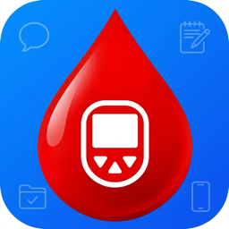
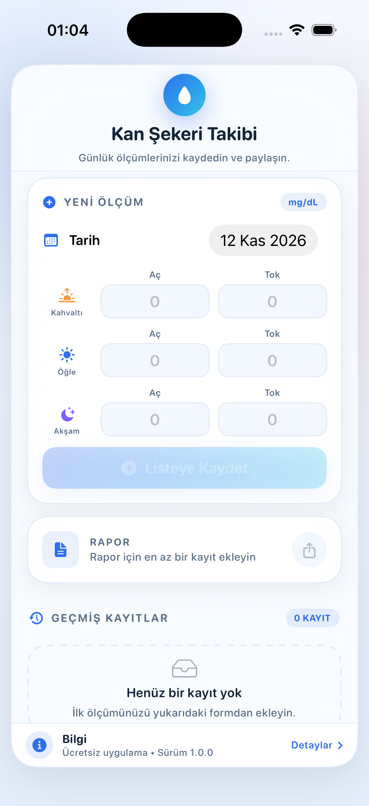
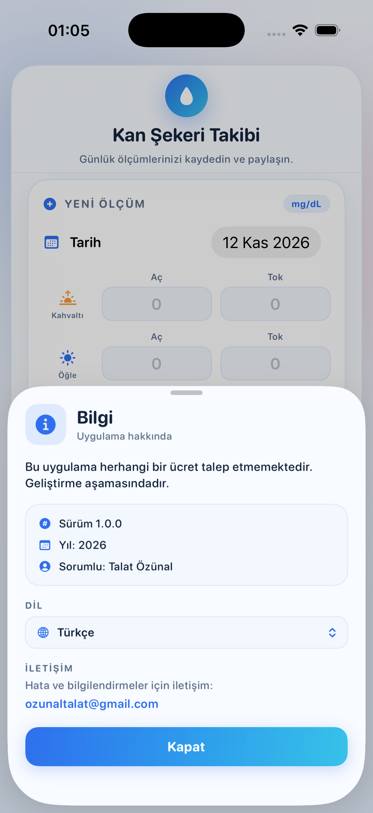

<p align="center">
  
</p>

<h1 align="center">Kan Şekeri Takibi</h1>

<p align="center">
  iPhone ve iPad için sakin, tek ekranlı bir kan şekeri günlüğü.<br>
  Sabah, öğle ve akşam ölçümlerinizi kaydedin, cihazınızda saklayın ve düzenli bir metin raporu olarak paylaşın.<br>
  Türkçe, İngilizce, Almanca, Fransızca ve İtalyanca olarak kullanılabilir.
</p>

<p align="center">
  <a href="README.md">English</a> · <b>Türkçe</b>
</p>

<p align="center">
  
  
  
  
</p>

---

## Genel bakış

**Kan Şekeri Takibi**, günlük kan şekeri ölçümlerini düzenli biçimde kaydetmeyi kolaylaştıran küçük bir SwiftUI uygulamasıdır. Her gün için **kahvaltı, öğle ve akşam** öğünlerinin **aç** ve **tok** değerlerini — yani tek ekrana rahatça sığan altı sayıyı — kaydeder.

Her şey cihazda kalır. Hesap yok, sunucu yok, analitik yok, üçüncü taraf bağımlılık yok.

## Bu uygulama neden var?

Diyabet yönetimi büyük ölçüde düzen meselesidir: doğru zamanlarda ölçmek ve ortaya çıkan tabloyu hekime gösterebilmek. Kâğıt defterler kaybolur; kapsamlı tıbbi uygulamalar ise basit bir günlük alışkanlığı için ağır gelebilir.

Bu uygulama bilinçli olarak dar tutuldu:

- **Tek iş** — bugünün ölçümlerini hızlıca yazmak.
- **Tek ekran** — sekme, menü, kurulum yok.
- **Tek cihaz** — veriler `AppStorage` içinde yerel olarak saklanır, hiçbir yere gönderilmez.
- **Tek dokunuşla paylaşım** — herhangi bir hekimin veya hemşirenin okuyabileceği düz metin raporu.

Bu bir kişisel takip aracıdır; **tıbbi cihaz değildir** ve **tıbbi tavsiyenin yerini tutmaz**.

## Ekran görüntüleri

<p align="center">
  
  &nbsp;&nbsp;
  
</p>

<p align="center">
  <sub>Ölçüm formu ve alttaki bilgi barı içeren ana ekran &nbsp;·&nbsp; Sürüm, yıl, sorumlu, dil seçici ve iletişim bilgisini gösteren bilgi paneli</sub>
</p>

## Özellikler

- **Günlük ölçüm formu** — tarih seçici ile kahvaltı, öğle ve akşam için aç/tok alanları (mg/dL).
- **“Bugün” kısayolu** — başka bir güne bakarken tarihi tek dokunuşla bugüne döndürür.
- **Güvenli kayıt** — en az bir değer girilene kadar kaydet butonu pasif kalır.
- **Geçmiş listesi** — en yeni kayıt üstte, kayıt sayısı, boş durum ipucu ve sola kaydırarak silme.
- **Metin raporu** — `SekerTakip.txt` oluşturur ve sistem paylaşım sayfasını açar; böylece kayıtlar e-posta, mesaj veya Dosyalar'a aktarılabilir.
- **Yerel saklama** — tüm geçmiş JSON olarak `@AppStorage` içine yazılır ve uygulama açılışında geri yüklenir.
- **Açık ve koyu mod** — dinamik renkler her iki görünümde de okunabilirliği korur.
- **Tek çerçeve düzeni** — her şey yuvarlatılmış tek bir kart içinde, ortalanmış ve iPad'de 620 pt ile sınırlı; hiçbir genişlikte yatay taşma olmaz.
- **Bilgi barı** — alt kenarda ince bir şerit; dokununca sürüm, yıl, sorumlu, iletişim adresi ve “Kapat” butonunu içeren panel açılır.
- **Beş dil** — Türkçe, İngilizce, Almanca, Fransızca ve İtalyanca; bilgi panelinden uygulama yeniden başlatılmadan değiştirilebilir.

## Diller

Arayüz **Türkçe, İngilizce, Almanca, Fransızca ve İtalyanca** olarak kullanılabilir. İlk açılışta cihaz dili esas alınır; dilediğiniz zaman **Bilgi → Dil** bölümünden uygulamayı yeniden başlatmadan değiştirebilirsiniz. Seçim `UserDefaults` (anahtar: `appLanguage`) içinde saklanır ve tüm etiketler, yer tutucular, tarihler ve rapor anında güncellenir.

Geliştirme dili Türkçe olduğu için yedek dil de Türkçedir: seçili dilde bir anahtar eksikse Türkçe metin gösterilir.

### Yeni dil ekleme

1. `<kod>.lproj` klasörlerinden birini (örneğin `en.lproj`) kopyalayıp yeni dil koduna göre adlandırın.
2. `Localizable.strings` ve `InfoPlist.strings` dosyalarını anahtarları değiştirmeden çevirin.
3. `Dil.swift` içindeki `Yerellestirme.desteklenenDiller` listesine kodu, `UygulamaDili` enum'una da bir case ekleyin.
4. Xcode projesindeki `knownRegions` listesine dili ekleyin.

Storyboard veya görsel değişikliği gerekmez.

## Nasıl kullanılır?

Bu belgedeki buton adları Türkçe gösterilmiştir; uygulama seçili dilde aynı terimleri kullanır.

1. Uygulamayı açın. Bugünün tarihi otomatik seçilidir.
2. Elinizdeki ölçümleri girin — örneğin kahvaltı aç `110`, tok `140`. Altı alanın tamamını doldurmak zorunda değilsiniz.
3. **Listeye Kaydet** butonuna dokunun. Kayıt, **Geçmiş Kayıtlar** bölümünün en üstünde görünür.
4. Bir kaydı silmek için sola kaydırın.
5. Kayıtları paylaşmak istediğinizde **Rapor** kartındaki **Paylaş** butonuna dokunun. Metin dosyası oluşturulur ve iOS paylaşım sayfası açılır.
6. Sürüm ve iletişim bilgileri için alttaki **Bilgi** barına dokunun.
7. Dili değiştirmek için **Bilgi** barına dokunun, **Dil** bölümünden bir dil seçin ve paneli kapatın — tüm arayüz anında güncellenir.

### Alan açıklamaları

| Alan | Anlamı |
|---|---|
| Kahvaltı / Aç | Kahvaltı öncesi (açlık) ölçümü |
| Kahvaltı / Tok | Kahvaltı sonrası (tokluk) ölçümü |
| Öğle / Aç | Öğle yemeği öncesi ölçüm |
| Öğle / Tok | Öğle yemeği sonrası ölçüm |
| Akşam / Aç | Akşam yemeği öncesi ölçüm |
| Akşam / Tok | Akşam yemeği sonrası ölçüm |

## Veri ve gizlilik

- Tüm kayıtlar **yalnızca bu cihazda**, `@AppStorage` (anahtar: `seker_takip_verileri`) aracılığıyla `UserDefaults` içinde JSON olarak saklanır.
- Uygulama **hiçbir ağ isteği yapmaz**.
- Oluşturulan rapor geçici bir `.txt` dosyasıdır; yalnızca paylaşım sayfasında bir hedef seçtiğinizde uygulamadan ayrılır.
- Uygulamayı silmek yerel verileri de siler. Bulut yedeği veya senkronizasyon yoktur.

## Bilgi barı

Ana çerçevenin altındaki şerit kalıcı ve küçüktür. Dokunulduğunda şunları içeren panel açılır:

- “Bu uygulama herhangi bir ücret talep etmemektedir. Geliştirme aşamasındadır.”
- Sürüm **1.0.0**, yıl **2026**, sorumlu **Talat Özünal**
- Anında uygulanan bir dil seçici (**Sistem** ve beş dil)
- İletişim: **ozunaltalat@gmail.com** (Mail uygulamasını açar)
- **Kapat** butonu

## Teknik yapı

| Katman | Seçim |
|---|---|
| Arayüz | SwiftUI |
| Durum | `@State`, `@AppStorage`, `@FocusState` |
| Saklama | `JSONEncoder` / `JSONDecoder` → `AppStorage` |
| Paylaşım | `ShareLink` + geçici metin dosyası |
| Tipografi | SF Rounded, 11–20 pt ağırlıklar |
| Palet | Mavi → cyan geçişi (`#2F6FED` → `#37C2E8`), yumuşak mavi yüzeyler |
| Bağımlılıklar | Yok |
| Minimum hedef | iOS 16.0 |
| Cihazlar | iPhone ve iPad (uyarlanabilir, en fazla 620 pt genişlik) |

## Proje yapısı

```
Kan Sekeri Takibi/
├── Kan Sekeri Takibi.xcodeproj
├── Kan Sekeri Takibi/
│   ├── Kan_Sekeri_TakibiApp.swift   # Uygulama giriş noktası
│   ├── ContentView.swift            # Model, tema, ana ekran, geçmiş, rapor
│   ├── BilgiBari.swift              # Bilgi barı + bilgi paneli
│   ├── Dil.swift                    # Dil yöneticisi + dil seçici
│   ├── tr.lproj … it.lproj/         # Localizable.strings + InfoPlist.strings
│   └── Assets.xcassets              # Uygulama simgesi ve vurgu rengi
├── docs/
│   ├── icon.png
│   └── screenshots/
├── README.md                        # İngilizce
└── README.tr.md                     # Türkçe
```

### Ana tipler

- `SekerOlcer` — `Codable` kayıt modeli (tarih + altı metin değeri).
- `Tema` — dinamik açık/koyu renkler ve mavi/cyan geçişi.
- `ContentView` — form, geçmiş, kalıcılık ve rapor üretimi.
- `BilgiBari` / `BilgiSayfasi` — alt bar ve bilgi paneli.
- `Yerellestirme` / `DilSecici` — `UserDefaults` içinde saklanan dil seçimi ve uygulama içi dil menüsü.

## Gereksinimler

- macOS ve **Xcode 16 veya üzeri** (proje yeni senkronize klasör biçimini kullanır).
- iOS **16.0+** simülatör veya cihaz.
- CocoaPods, Swift Package Manager paketi veya ek kurulum gerekmez.

## Derleme ve çalıştırma

```bash
git clone https://github.com/talatozunal/Kan-Sekeri-Takibi.git
cd Kan-Sekeri-Takibi
open "Kan Sekeri Takibi.xcodeproj"
```

**Kan Sekeri Takibi** şemasını seçip bir iPhone simülatöründe veya cihazda çalıştırın.

Cihazda çalıştırmak için *Signing & Capabilities* altında kendi **Team**'inizi seçin. Paket kimliği `com.talatev.KanSekeriTakibi`; hesabınızla çakışırsa değiştirebilirsiniz.

Komut satırından derleme:

```bash
xcodebuild -project "Kan Sekeri Takibi.xcodeproj" \
  -scheme "Kan Sekeri Takibi" \
  -destination 'generic/platform=iOS Simulator' build
```

## Notlar ve sınırlamalar

- Değerler girildiği biçimde metin olarak saklanır; uygulama yorumlamaz, doğrulamaz veya birim dönüştürmez. Arayüzde birim **mg/dL** olarak etiketlenmiştir.
- Kaydedilmiş bir kayıt henüz düzenlenemiyor — değer yanlışsa silip yeniden girin.
- Rapor düz metindir ve oluşturulduğu andaki geçmişi yansıtır.
- Proje geliştirme aşamasındadır; uygulama içindeki bilgi paneli de bunu belirtir.

## Sorumluluk reddi

Bu uygulama kişisel kayıt tutma yardımcısıdır. Herhangi bir rahatsızlığı **teşhis etmez, tedavi etmez, iyileştirmez veya önlemez**; **tıbbi cihaz değildir**. Her zaman yetkin bir sağlık profesyonelinin tavsiyelerine uyun; burada kaydettiğiniz bir değere dayanarak tıbbi bakımı asla ertelemeyin veya ihmal etmeyin.

## Lisans

[MIT Lisansı](LICENSE) ile yayımlanmıştır. © 2026 Talat Özünal.

## İletişim

Soru, hata bildirimi ve öneriler: **ozunaltalat@gmail.com**
